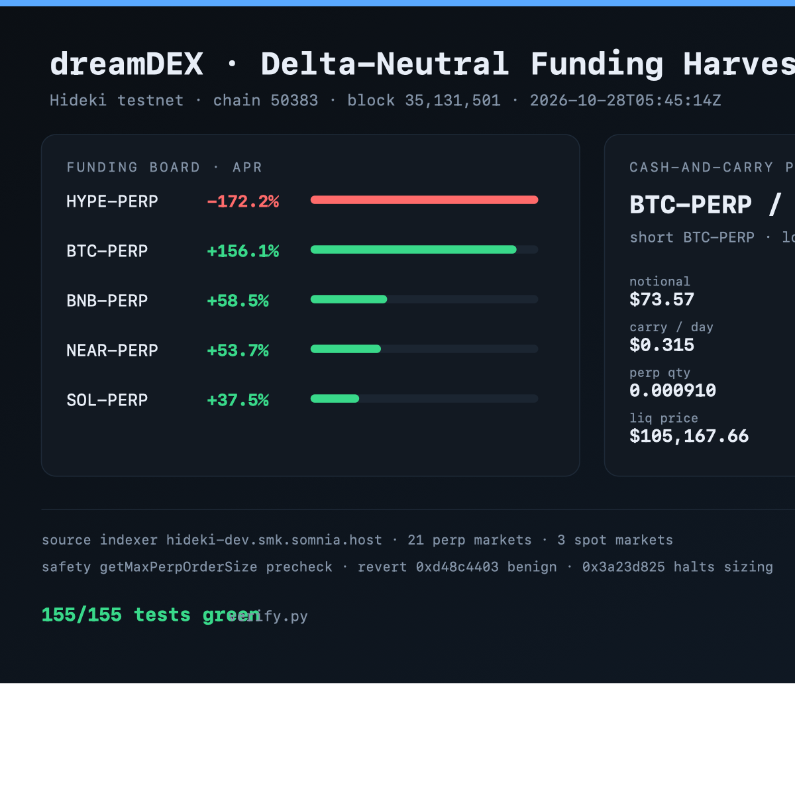

# dreamDEX Perps Agent — delta-neutral funding harvester

A working agent for [DreamDEX](https://dreamdex.io) perpetuals on the Somnia **Hideki** testnet
(chain 50383). It finds perp/spot pairs where funding pays the short, sizes both legs on the
venue's own grid, checks the venue's own `getMaxPerpOrderSize`, and refuses to send when any
gate says no.



```
155 tests · 0.44 s · chain 50383 · block 35,133,148 · BTC-PERP funding +156.08% APR
```

## What it does

1. **Reads the live book** — the official Hasura indexer for 21 perp + 3 spot markets, plus one
   RPC call for the block number. The analytics layer is stdlib-only Python (`urllib`), so it
   runs on a clean machine with nothing installed.
2. **Normalises funding correctly** — the stored rate covers the *calculation window* (8 h),
   while settlement happens every hour. Dividing by the wrong one overstates APR by exactly 8×.
   `agent/funding.py` is the single place that division happens, and it is tested.
3. **Builds a cash-and-carry plan** — long the spot (`WBTC`/`WETH`), short the perp, same
   notional. Only positive funding is executable: the reverse trade needs a spot short the venue
   does not offer.
4. **Checks before it trades** — `getMaxPerpOrderSize` is not a view; the SDK binary-searches
   the MarginBank. The agent shells out to `bridge/precheck.mjs` for that authoritative number
   and labels its own arithmetic as a fallback bound.
5. **Survives the reverts** — `0xd48c4403` (IOC no fill) is benign and skips the cycle;
   `0x3a23d825` (insufficient collateral) halts and re-sizes instead of retrying.
6. **Leaves an artifact** — `out/card.svg` / `.png` is a self-contained state card with the
   funding board, the plan, the liquidation buffer and the block the numbers came from.

## The trade

```
        funding paid by longs  ────────────────►  received by the short
                                                          │
   spot wallet:  LONG  WBTC  ── delta +q ──┐              │
                                           ├── net delta ≈ 0
   perps wallet: SHORT BTC-PERP ── delta −q ┘              │
                                                          ▼
                                        carry = notional × funding rate
```

The legs are **not cross-margined**. A perp margin call can fire while the spot leg is in
profit, which is why every plan carries a liquidation price, a buffer, and a note telling you to
top up margin before the mark moves. That is a real risk, not a footnote.

## Quickstart

```bash
# no install, no network: fixture + 155 tests
python3 verify.py --offline

# live indexer + card
python3 verify.py

# live indexer + the SDK's own sizing answer for an account
python3 verify.py --account 0x72Aa6edDE71B94f6b99c8e52EdC02B5C75F74d1a
```

The SDK bridge (only needed for the authoritative precheck and for placing):

```bash
npm --prefix bridge install     # 113 MB, @somnia-chain/markets-sdk
node bridge/precheck.mjs --pool 0x4181… --margin-bank 0x4787… \
  --account 0x72Aa… --price 80865000000000000000000 --is-bid false
```

## Commands

```console
$ python3 -m agent scan --fixture
dreamDEX delta-neutral harvester  ·  Hideki 50383  ·  block 35,092,159
market               mark      APR%  /int bps  basis bps           OI
BTC-PERP      80,865.0873   +157.20     1.795     -3.743       342.87
HYPE-PERP         81.2092   -131.56    -1.502     -5.520    32,557.73
BNB-PERP        745.3369    +57.50     0.656     +0.372       269.74

$ python3 -m agent plan --fixture
pair                               APR%    basis    notional      day$    BE h  liq buf  status
BTC-PERP / WBTC/USDso           +157.20  -0.037%       73.59     0.317    11.1   30.08%  ready
ETH-PERP / WETH/USDso            +10.95  -0.043%       74.54     0.022   160.0   30.08%  fee break-even 160.0h above the 72h limit

best plan  BTC-PERP / WBTC/USDso
  legs        short BTC-PERP 0.000910 @ 80,865  |  long WBTC/USDso 0.000909 @ 80,928
  capital     $100.00  ->  spot $73.59 + margin $24.53  (leverage 3.00x, efficiency 0.74x)
  carry       APR +157.20%  ·  $0.317/day  ·  fees $0.147  ·  break-even 11.1h
  risk        liq $105,190 (+30.08% away)  ·  maintenance 2.50%  ·  basis -0.037%
```

| command | what it does | network |
| --- | --- | --- |
| `scan` | funding board, APR normalised to the 8 h window | indexer |
| `plan` | ranked cash-and-carry plans with blockers | indexer |
| `pairs` | the perp↔spot pairs the venue actually lists | indexer |
| `check` | `getMaxPerpOrderSize` for one account | RPC + SDK |
| `card` | writes `out/card.svg` (and PNG) | none |
| `run` | plan → precheck → optional order; dry-run by default | all |

`--json` is available on `scan`, `plan` and `check` and prints *only* JSON, so it pipes into
`jq` without prose cleanup.

## Safety model

- **Dry run is the default.** `run` needs both `--execute` and `--yes`; without them it journals
  the plan and exits.
- **The venue's answer wins.** If `precheck.mjs` returns `placeable: false` or a max below the
  plan, the order is refused. The Python sizing is a labelled bound (`source: "analytic"`), never
  a substitute.
- **Reverts are classified, not swallowed.**

  | selector | name | disposition |
  | --- | --- | --- |
  | `0xd48c4403` | `ImmediateOrCancelNoFill` | benign — book moved, skip the cycle |
  | `0x3a23d825` | `InsufficientCollateral` | halt, re-read decimals and balance, re-size |
  | `0x782b2567` | `InsufficientGasForPayout` | native-base buy below the 5M gas floor |

- **Refuses malformed markets.** No pool address, no mark, or a size below `minQuantity` stops
  the run instead of producing a zero-size order.
- **No secrets in the repo.** The bridge reads `PRIVATE_KEY` from the environment; nothing is
  written to disk.

## Architecture

```
agent/            stdlib-only Python
  config.py       chain 50383, contract singletons, error selectors
  models.py       Market / PoolParams / Book / Snapshot, Decimal money
  funding.py      window-vs-interval normalisation (the 8× guard)
  risk.py         PnL, liquidation, margin health, lot/tick alignment
  strategy.py     pair discovery, planning, ranking
  indexer.py      GraphQL + one RPC call, fixture round-trip
  precheck.py     revert decoder + SDK bridge / analytic fallback
  terminal.py     ANSI tables
  card.py         dependency-free SVG
  cli.py          scan / plan / pairs / check / card / run
bridge/           Node, the only write path
  precheck.mjs    getMaxPerpOrderSize (binary search inside the SDK)
  place.mjs       placePerpOrder, --dry-run by default
tests/            155 tests, no network, no node
verify.py         tests + fixture + live smoke + card in one command
```

Why two languages: the analytics must be auditable and dependency-free, but sizing and placement
must be *the venue's own code*. Re-implementing `getMaxPerpOrderSize` in Python would be a second
opinion the pool does not share.

## Tests

```
$ python3 verify.py --offline
1. unit suite      ok  155/155 tests  0.42s
2. captured fixture ok  21 perps / 3 spots  block 35,092,159
4. plan            ok  BTC-PERP / WBTC/USDso executable  APR +157.20% · $0.317/day · liq buffer 30.08%
6. card            ok  out/card.svg
verify passed in 1.26s · 155 tests
```

Covered: money parsing and decimals (8 vs 18 vs 9), fee scaling, funding normalisation and
truncation, carry sign, liquidation for both sides, lot/tick alignment, minimum size, capital
split, delta neutrality within one lot, ranking, revert decoding, SDK fallback, GraphQL transport
errors, fixture round-trip, every CLI exit code, and the card's escaping.

## Live evidence

| what | value | when |
| --- | --- | --- |
| indexer | 21 perp / 3 spot markets | block 35,133,148 |
| widest funding | HYPE-PERP −172.2% APR (not executable: needs a spot short) | same block |
| best executable | BTC-PERP / WBTC/USDso +156.08% APR, $0.315/day on $100 | same block |
| SDK precheck | `placeable:false, maxQuantity:0, limitedBy:"collateral"` for the unfunded key | block 35,093,333 |

Raw logs: `out/live-scan.json`, `out/live-plan.json`, `out/runlog.jsonl`.

### The one thing that is not done

A real order needs USDso **in the Perps MarginBank** and STT for gas. Both worker addresses hold
**0 STT** and **0 USDso**; the credit-voucher campaign (`getPerpVoucherEligibility`) is the
intended way in, but a claim is itself a transaction and needs gas. The agent is complete and
verified up to the send: precheck answers, sizing is exact, the order path is wired through the
SDK. The blocker is funding, not code, and it is documented rather than hidden.

## Findings

Four reproducible issues found while building this, with one-command reproducers in `scripts/`:
`perpStatus` is `null` on all 21 markets, the funding-rate window is undocumented (8× trap), the
docs' testnet chain id (50312) is not the chain the perps run on (50383), and the fee field's
scale is only inferable from the mainnet builder cap. See [docs/FINDINGS.md](docs/FINDINGS.md).

## X posts

Posts tagging [@DreamDEXSomnia](https://x.com/DreamDEXSomnia), as required by the MVP track:

1. > Building a delta-neutral funding harvester for @DreamDEXSomnia. It reads 21 perp markets,
   > normalises the 8h funding window, and refuses to send unless the venue's own
   > `getMaxPerpOrderSize` agrees. 155 tests, stdlib-only Python + the official SDK for the write
   > path. github.com/9xj89gzrtw-hue/dreamdex-perps-agent
2. > The trap in perp funding: the stored rate covers the 8h calculation window but settles
   > hourly. Annualise without dividing and you overstate by exactly 8×. BTC-PERP reads 156% APR,
   > not 1250%. @DreamDEXSomnia
3. > Found while building: `perpStatus` is null on all 21 @DreamDEXSomnia markets, so a client
   > cannot tell halted from active. Filed with a one-command reproducer:
   > `scripts/repro_perp_status.sh`.

## Status

- [x] live indexer, funding normalisation, planning, ranking
- [x] authoritative SDK precheck wired and exercised live
- [x] revert classification and refusal gates
- [x] 155 tests, `verify.py`, SVG/PNG card
- [x] findings with reproducers
- [ ] first real testnet order — blocked on STT gas + USDso collateral

## Disclaimer

Educational reference code, not financial advice, not audited. Testnet only. Any strategy can
lose money; a funding carry can lose more than it earns when the basis moves.
